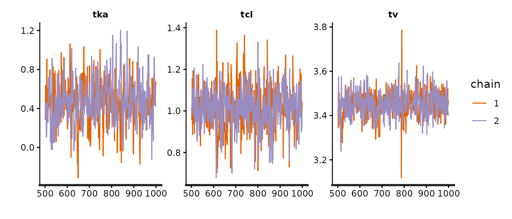
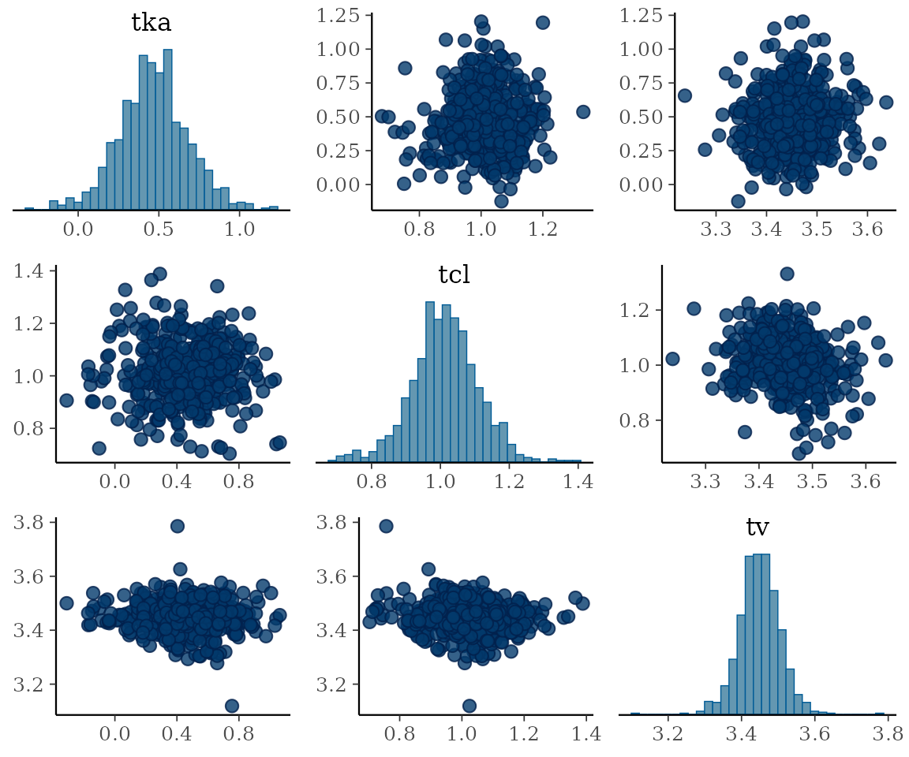

# Bayesian estimation with est="nuts"

## Automatic model generation: likelihood-level linking

`nlmixr2bayes` adds a Bayesian HMC estimation method to nlmixr2 that
**automatically generates and compiles a Stan program**. You write the
model once, in nlmixr2 syntax, declare priors in the `ini({})` block,
and `est = "nuts"` handles everything else: Stan program generation,
compilation, linking, and sampling. **No Stan code to write** – this
vignette is for you.

`est = "nuts"` names the ALGORITHM (Stan’s No-U-Turn HMC sampler) rather
than the software tool – it is sugar for `est = "stan"` with NUTS, which
is
[`stanControl()`](https://nlmixr2.github.io/nlmixr2bayes/reference/stanControl.md)’s
default anyway, so the two are equivalent here.

### When to use this approach

- You want Bayesian estimation of a complete nlmixr2 model
- You prefer automatic program generation over hand-coding Stan
- Your model fits the supported scope (ODE, `linCmt()`, normal/censored
  errors, finite mixtures)
- You want the same likelihood evaluated by every nlmixr2 method (FOCE,
  Stan, etc.)

### When to use hand-coded Stan instead

If you want **full control over your Stan program** – custom priors,
derived quantities, multiple endpoints with mixed structures, or a
hierarchy the nlmixr2 ui cannot express – see
[`vignette("rxstan-handcoded", "nlmixr2bayes")`](https://nlmixr2.github.io/nlmixr2bayes/articles/rxstan-handcoded.md)
for the rxstan approach. Delay differential equations are *not* a reason
to go there: `delay()` and `past()` work through this automatic path too
(see
[`vignette("rxstan-dde", "nlmixr2bayes")`](https://nlmixr2.github.io/nlmixr2bayes/articles/rxstan-dde.md)).

------------------------------------------------------------------------

Stan is **linked** to the compiled rxode2/nlmixr2est likelihood rather
than the model being translated into Stan’s language: rxode2 solves the
ODEs (dosing events, `addl`, infusions, steady state), and nlmixr2est
evaluates the same conditional likelihood every other nlmixr2 method
uses – one source of truth, with analytic gradients handed to Stan
through `precomputed_gradients()`. Stan samples theta, the omega
parameters, and the individual etas jointly; the eta prior is fully
owned by Stan (non-centered by default), so its autodiff composes the
supplied gradients through the Omega parameterization. A model with
**no** etas (a population-only or single-subject fit) runs as “tier 0”
through nlmixr2est’s nlm path instead – one external scalar carrying the
whole data log-likelihood with its analytic gradient.

Because Stan only ever sees the likelihood, anything rxode2 can solve is
in scope without the generator knowing about it – **delay differential
equations** included. `d/dt(R) <- kin - kout * delay(R, tau)` is an
ordinary model here, with `tau` estimated like any other theta; rxode2
switches to a dense solver for it exactly as it does under FOCEi or
SAEM. Stan itself has no DDE solver at all, so this is a capability that
exists only because the model is linked rather than translated.

Beyond the core: finite mixtures (`mix()`, 2 components) marginalize
with the Stan `log_sum_exp` pattern and put per-subject membership
posteriors in `fit$env$mixProb`; fixed-variance etas (`eta ~ fix(v)`)
render as constant Cholesky factors with the eta still sampled; and an
estimated transform-both-sides lambda (Box-Cox/Yeo-Johnson, including on
`logitNorm`/`probitNorm` bases) is handled with the DV-transform
Jacobian emitted Stan-side.

## Priors come from `ini({})`

Priors are declared next to the parameters they describe, with the
lotri/rxode2 prior syntax – the distribution catalog is one-to-one with
Stan’s
([`lotri::lotriPriorDists()`](https://nlmixr2.github.io/lotri/reference/lotriPriorDists.html)).

The model below is the standard one-compartment oral theophylline model,
with between-subject variability on `ka`, `cl` and `v` and an additive
residual error, plus one `prior()` line per estimated parameter:

``` r

library(nlmixr2)
library(nlmixr2bayes)

one.cmt <- function() {
  ini({
    tka <- 0.45
    tcl <- log(c(0, 2.7, 100))
    tv <- 3.45
    add.sd <- c(0, 0.7)
    eta.ka ~ 0.6
    eta.cl ~ 0.3
    eta.v ~ 0.1
    prior(tka) ~ dnorm(0.45, 1)
    prior(tcl) ~ dnorm(1, 1)
    prior(tv) ~ dnorm(3.45, 1)
    prior(add.sd) ~ dcauchy(0, 2.5)
  })
  model({
    ka <- exp(tka + eta.ka)
    cl <- exp(tcl + eta.cl)
    v <- exp(tv + eta.v)
    linCmt() ~ add(add.sd)
  })
}
```

Fitting it is one call. The `:=` here is nlmixr2save’s caching
assignment (see `vignettes/cacheSetup.R`): the first render runs the
sampler for real and writes the fit into `inst/cache`, and every later
render loads it back, so the numbers on this page are the ones the code
produced. Written with `<-` instead, the line is an ordinary fit that
runs every time:

``` r

fit := nlmixr2est::nlmixr2(one.cmt, nlmixr2data::theo_sd, est = "nuts",
                           control = nutsControl(seed = 42, chains = 2,
                                                 iter = 1000))
```

A short run (2 chains of 1000, half of them warmup) keeps this page
quick to rebuild and its cached fit small; the defaults are 4 chains of
2000, which is what you want for a real analysis.

The result prints as an ordinary nlmixr2 fit, with the sampler’s
headline diagnostics in the header and the posterior summarized in the
usual parameter table:

``` r

print(fit)
#> ── nlmixr² Stan (HMC) (2 chains x 500 draws; max Rhat 1.004; min ESS 358; Wald
#> CI from posterior cov) ──
#> 
#>                                  OBJF      AIC      BIC Log-likelihood
#> FOCEi                       127.77345 384.3732 404.5528      -185.1866
#> WAIC (subject-level)         68.96340       NA       NA       -34.4817
#> LOO (leave-one-subject-out)  80.38441       NA       NA       -40.1922
#>                             Condition#(Cov) Condition#(Cor)
#> FOCEi                              16.28524        1.462288
#> WAIC (subject-level)                     NA              NA
#> LOO (leave-one-subject-out)              NA              NA
#> 
#> ── Time (sec $time): ──
#> 
#>              setup   optimize covariance preprocess postprocess table compress
#> elapsed 0.07425366 3.6172e-05  2.151e-05      0.039       0.013 0.034    0.006
#> 
#> ── Population Parameters ($parFixed or $parFixedDf): ──
#> 
#>         Est.     SE %RSE Back-transformed(95%CI) BSV(CV%) Shrink(SD)%
#> tka    0.468  0.215 46.0       1.60 (1.05, 2.43)     97.3       18.3 
#> tcl     1.01 0.0980 9.68       2.75 (2.27, 3.34)     32.9       19.7 
#> tv      3.45 0.0561 1.63       31.5 (28.2, 35.1)     17.1       26.4 
#> add.sd 0.707 0.0541 7.65    0.707 (0.601, 0.813)                     
#>  
#>   Covariance Type ($covMethod): stan.posterior
#>   Fixed parameter correlations in $cor
#>   No correlations in between subject variability (BSV) matrix
#>   Full BSV covariance ($omega) or correlation ($omegaR; diagonals=SDs) 
#>   Distribution stats (mean/skewness/kurtosis/p-value) available in $shrink 
#>   Information about run found ($runInfo):
#>    • Bulk Effective Samples Size (ESS) is too low, indicating posterior means and medians may be unreliable. Running the chains for more iterations may help. See https://mc-stan.org/misc/warnings.html#bulk-ess 
#>   Censoring ($censInformation): No censoring
#> 
#> ── Fit Data (object is a modified tibble): ──
#> # A tibble: 132 × 18
#>   ID     TIME    DV  PRED    RES IPRED   IRES  IWRES eta.ka eta.cl   eta.v depot
#>   <fct> <dbl> <dbl> <dbl>  <dbl> <dbl>  <dbl>  <dbl>  <dbl>  <dbl>   <dbl> <dbl>
#> 1 1      0     0.74  0     0.74   0     0.74   1.05  0.0875 -0.491 -0.0768  320.
#> 2 1      0.25  2.84  3.31 -0.465  3.84 -1.00  -1.42  0.0875 -0.491 -0.0768  207.
#> 3 1      0.57  6.57  5.90  0.670  6.78 -0.208 -0.294 0.0875 -0.491 -0.0768  119.
#> # ℹ 129 more rows
#> # ℹ 6 more variables: central <dbl>, ka <dbl>, cl <dbl>, v <dbl>, tad <dbl>,
#> #   dosenum <int>
```

Notes on how priors are handled:

- A parameter’s `ini()` bounds become Stan constraints;
  `add.sd <- c(0, 0.7)` with `prior(add.sd) ~ dcauchy(0, 2.5)` is the
  half-Cauchy idiom (`real<lower=0>` + `cauchy(0, 2.5)`).
- A prior whose support is narrower than the declared bounds tightens
  the declaration (support promotion); truncation `T[L,U]` is emitted
  only when the dropped normalizer would be parameter-dependent.
- Omega blocks: write `prior(eta.x) ~ invWishart(nu)` for an
  inverse-Wishart on the block, or leave the block without a prior to
  get the announced default – `lkj_corr_cholesky(2)` on the correlation
  plus half-Cauchy priors on each SD.
- A model with **no** priors is refused, and the error prints the exact
  `prior()` lines to add. Bayesian output from silently invented priors
  would look publishable and be wrong.
- Parameters that are [`fix()`](https://rdrr.io/r/utils/fix.html)ed are
  dissolved before generation (`literalFix = TRUE`); a prior on a fixed
  parameter is an error.

That refusal is worth seeing, because the error is also the fix – it
prints the `prior()` lines to paste back into `ini({})`:

``` r

noPriors <- function() {
  ini({
    tka <- 0.45
    tcl <- log(c(0, 2.7, 100))
    tv <- 3.45
    add.sd <- c(0, 0.7)
    eta.ka ~ 0.6
    eta.cl ~ 0.3
    eta.v ~ 0.1
  })
  model({
    ka <- exp(tka + eta.ka)
    cl <- exp(tcl + eta.cl)
    v <- exp(tv + eta.v)
    linCmt() ~ add(add.sd)
  })
}
nlmixr2est::nlmixr2(noPriors, nlmixr2data::theo_sd, est = "nuts")
#> Error:
#> ! est="stan" needs prior distributions in the ini({}) block and this model declares none; for example:
#>   prior(tka) ~ dnorm(0.45, 10)
#>   prior(tcl) ~ dnorm(0.993, 10)
#>   prior(tv) ~ dnorm(3.45, 34.5)
#>   prior(add.sd) ~ dcauchy(0, 3.5)
#>   prior(eta.ka) ~ invWishart(6)
```

Those suggested priors are derived from the model’s own `ini()` values
and bounds; they are a starting point to edit, not a recommendation.

## Controlling the run

[`stanControl()`](https://nlmixr2.github.io/nlmixr2bayes/reference/stanControl.md)
collects everything about the run. Calling it on its own returns the
control object, which is also how you can check what a setting resolved
to before spending an hour on a fit:

``` r

stanControl(
  chains = 4, iter = 2000, warmup = 1000, seed = 42,
  adapt_delta = 0.8, max_treedepth = 10, # Stan's own sampler defaults
  init = "ini",          # chains start at the ini() estimates (jittered)
  etaParam = "noncentered",  # or "centered"; both target the identical posterior
  cores = 4,          # subject-parallel threads INSIDE each evaluation
  print = 100         # nlmixr2est-style iteration table cadence (0 = off)
)
#> $chains
#> [1] 4
#> 
#> $iter
#> [1] 2000
#> 
#> $algorithm
#> [1] "NUTS"
#> 
#> $pathfinderPaths
#> [1] 4
#> 
#> $vbIter
#> [1] 10000
#> 
#> $vbTolRelObj
#> [1] 0.01
#> 
#> $vbOutputSamples
#> [1] 1000
#> 
#> $warmup
#> [1] 1000
#> 
#> $thin
#> [1] 1
#> 
#> $seed
#> [1] 42
#> 
#> $init
#> [1] "ini"
#> 
#> $initJitterSd
#> [1] 0.1
#> 
#> $adapt_delta
#> [1] 0.8
#> 
#> $max_treedepth
#> [1] 10
#> 
#> $likelihood
#> [1] "focei"
#> 
#> $etaParam
#> [1] "noncentered"
#> 
#> $cores
#> [1] 4
#> 
#> $print
#> [1] 100
#> 
#> $maxOdeRecalc
#> [1] 3
#> 
#> $fallbackFD
#> [1] TRUE
#> 
#> $chainCores
#> [1] 2
#> 
#> $diagOmegaSdPrior
#> [1] "cauchy(0, %s)"
#> 
#> $lkjEta
#> [1] 2
#> 
#> $point
#> [1] "mean"
#> 
#> $ofv
#> [1] "focei"
#> 
#> $rhatMax
#> [1] 1.01
#> 
#> $essBulkMin
#> [1] 100
#> 
#> $essTailMin
#> [1] 100
#> 
#> $maxDivergent
#> [1] 0
#> 
#> $onDiagnostic
#> [1] "warn"
#> 
#> $run
#> [1] TRUE
#> 
#> $cache
#> [1] TRUE
#> 
#> $cacheDir
#> NULL
#> 
#> $stanFile
#> NULL
#> 
#> $verbose
#> [1] FALSE
#> 
#> $sigdig
#> [1] 8
#> 
#> $rxControl
#> $scale
#> NULL
#> 
#> $method
#> [1] 0
#> 
#> $atol
#> [1] 1e-08
#> 
#> $rtol
#> [1] 1e-08
#> 
#> $maxsteps
#> [1] 100000
#> 
#> $hmin
#> [1] 0
#> 
#> $hmax
#> NULL
#> 
#> $hini
#> [1] 0
#> 
#> $maxordn
#> [1] 12
#> 
#> $maxords
#> [1] 5
#> 
#> $covsInterpolation
#> locf 
#>    1 
#> 
#> $addCov
#> [1] TRUE
#> 
#> $returnType
#> rxSolve 
#>       0 
#> 
#> $sigma
#> NULL
#> 
#> $sigmaDf
#> NULL
#> 
#> $nCoresRV
#> [1] 1
#> 
#> $sigmaIsChol
#> [1] FALSE
#> 
#> $sigmaSeparation
#> [1] "auto"
#> 
#> $sigmaXform
#> identity 
#>        4 
#> 
#> $nDisplayProgress
#> [1] 10000
#> 
#> $amountUnits
#> [1] NA
#> 
#> $timeUnits
#> [1] "hours"
#> 
#> $addDosing
#> [1] FALSE
#> 
#> $stateTrim
#> [1] Inf
#> 
#> $updateObject
#> [1] FALSE
#> 
#> $omega
#> NULL
#> 
#> $omegaDf
#> NULL
#> 
#> $omegaIsChol
#> [1] FALSE
#> 
#> $omegaSeparation
#> [1] "auto"
#> 
#> $omegaXform
#> variance 
#>        6 
#> 
#> $nSub
#> [1] 1
#> 
#> $thetaMat
#> NULL
#> 
#> $thetaDf
#> NULL
#> 
#> $thetaIsChol
#> [1] FALSE
#> 
#> $nStud
#> [1] 1
#> 
#> $dfSub
#> [1] 0
#> 
#> $dfObs
#> [1] 0
#> 
#> $seed
#> NULL
#> 
#> $nsim
#> NULL
#> 
#> $minSS
#> [1] 10
#> 
#> $maxSS
#> [1] 10000
#> 
#> $strictSS
#> [1] 1
#> 
#> $infSSstep
#> [1] 12
#> 
#> $istateReset
#> [1] TRUE
#> 
#> $subsetNonmem
#> [1] TRUE
#> 
#> $hmaxSd
#> [1] 0
#> 
#> $maxAtolRtolFactor
#> [1] 0.1
#> 
#> $from
#> NULL
#> 
#> $to
#> NULL
#> 
#> $by
#> NULL
#> 
#> $length.out
#> NULL
#> 
#> $iCov
#> NULL
#> 
#> $keep
#> NULL
#> 
#> $keepF
#> character(0)
#> 
#> $drop
#> NULL
#> 
#> $warnDrop
#> [1] TRUE
#> 
#> $omegaLower
#> [1] -Inf
#> 
#> $omegaUpper
#> [1] Inf
#> 
#> $sigmaLower
#> [1] -Inf
#> 
#> $sigmaUpper
#> [1] Inf
#> 
#> $thetaLower
#> [1] -Inf
#> 
#> $thetaUpper
#> [1] Inf
#> 
#> $indLinPhiM
#> [1] 0
#> 
#> $indLinPhiTol
#> [1] 1e-07
#> 
#> $indLinMatExpType
#> Al-Mohy 
#>       3 
#> 
#> $indLinMatExpOrder
#> [1] 6
#> 
#> $idFactor
#> [1] TRUE
#> 
#> $mxhnil
#> [1] 0
#> 
#> $hmxi
#> [1] 0
#> 
#> $warnIdSort
#> [1] TRUE
#> 
#> $ssAtol
#> [1] 1e-08
#> 
#> $ssRtol
#> [1] 1e-08
#> 
#> $safeZero
#> [1] 1
#> 
#> $sumType
#> pairwise 
#>        1 
#> 
#> $prodType
#> long double 
#>           1 
#> 
#> $resample
#> NULL
#> 
#> $resampleID
#> [1] TRUE
#> 
#> $maxwhile
#> [1] 100000
#> 
#> $cores
#> [1] 0
#> 
#> $atolSens
#> [1] 1e-08
#> 
#> $rtolSens
#> [1] 1e-06
#> 
#> $ssAtolSens
#> [1] 1e-08
#> 
#> $ssRtolSens
#> [1] 1e-06
#> 
#> $simVariability
#> [1] NA
#> 
#> $nLlikAlloc
#> NULL
#> 
#> $useStdPow
#> [1] 0
#> 
#> $naTimeHandle
#> ignore 
#>      1 
#> 
#> $addlKeepsCov
#> [1] FALSE
#> 
#> $addlDropSs
#> [1] TRUE
#> 
#> $ssAtDoseTime
#> [1] TRUE
#> 
#> $ss2cancelAllPending
#> [1] FALSE
#> 
#> $naInterpolation
#> locf 
#>    1 
#> 
#> $keepInterpolation
#> na 
#>  2 
#> 
#> $safeLog
#> [1] 1
#> 
#> $safePow
#> [1] 1
#> 
#> $ssSolved
#> [1] TRUE
#> 
#> $linCmtSensType
#> auto 
#>  100 
#> 
#> $linCmtSensH
#> [1] 1e-04
#> 
#> $linCmtGillFtol
#> [1] 0
#> 
#> $linCmtGillK
#> [1] 20
#> 
#> $linCmtGillStep
#> [1] 4
#> 
#> $linCmtGillRtol
#> [1] 1.490116e-08
#> 
#> $linCmtShiErr
#> [1] 1.490116e-08
#> 
#> $linCmtShiMax
#> [1] 20
#> 
#> $linCmtScale
#> [1] 0 0 0 0 0 0 0
#> 
#> $linCmtHcmt
#> [1] 1
#> 
#> $linCmtHmeanI
#> geometric 
#>         2 
#> 
#> $linCmtHmeanO
#> geometric 
#>         2 
#> 
#> $linCmtSuspect
#> [1] 1e-06
#> 
#> $linCmtForwardMax
#> [1] 2
#> 
#> $indOwnAlloc
#> [1] -1
#> 
#> $maxExtra
#> [1] 1000
#> 
#> $tolFactor
#> NULL
#> 
#> $serializeFile
#> NULL
#> 
#> $dense
#> [1] TRUE
#> 
#> $cvodeLinSolver
#> dense 
#>     1 
#> 
#> $stiff2
#> [1] 13
#> 
#> $autoSwitchMaxStiff
#> [1] 10
#> 
#> $autoSwitchMaxNonstiff
#> [1] 3
#> 
#> $autoSwitchStiffFirst
#> [1] 0
#> 
#> $autoSwitchNonstifftol
#> [1] 0.9
#> 
#> $autoSwitchStifftol
#> [1] 0.9
#> 
#> $autoSwitchDtfac
#> [1] 2
#> 
#> $autoSwitchSwitchMax
#> [1] 5
#> 
#> $useLinCmt
#> [1] FALSE
#> 
#> $file
#> NULL
#> 
#> $chunkSize
#> NULL
#> 
#> $parallel
#> [1] 0
#> 
#> $.zeros
#> NULL
#> 
#> $zeroVarParamHandle
#> [1] "warn"
#> 
#> $indLinStepSearch
#> [1] 1
#> 
#> $indLinMaxIter
#> [1] 20
#> 
#> $indLinRichardson
#> [1] 2
#> 
#> $indLinIteration
#> [1] 3
#> 
#> $indLinJac
#> [1] 0
#> 
#> $indLinForcing
#> [1] 1
#> 
#> $usePrior
#> [1] NA
#> 
#> $priorPdRetry
#> [1] 10
#> 
#> $priorOmega
#> NULL
#> 
#> $priorOmegaEl
#> NULL
#> 
#> $priorSigmaEl
#> NULL
#> 
#> $linCmtSensPhi
#> [1] 2
#> 
#> $nonmem
#> [1] FALSE
#> 
#> attr(,"class")
#> [1] "rxControl"
#> 
#> $genRxControl
#> [1] TRUE
#> 
#> $addProp
#> [1] "combined2"
#> 
#> $sumProd
#> [1] FALSE
#> 
#> $optExpression
#> [1] TRUE
#> 
#> $literalFix
#> [1] TRUE
#> 
#> $calcTables
#> [1] TRUE
#> 
#> $compress
#> [1] TRUE
#> 
#> $ci
#> [1] 0.95
#> 
#> $sigdigTable
#> NULL
#> 
#> attr(,"class")
#> [1] "stanControl"
```

Parallelism has two axes. By default (unix) the chains run in FORKED
processes (`chainCores`, inheriting the
[`rxode2::getRxThreads()`](https://nlmixr2.github.io/rxode2/reference/getRxThreads.html)
budget capped at the chain count): each fork receives a copy-on-write
duplicate of the linked likelihood, and the draws are bit-identical to a
sequential run. With `chainCores = 1` the chains run sequentially and
each likelihood evaluation is subject-parallel instead (`cores`, default
`getRxThreads()`; CRAN’s two-core policy is honored automatically
through `OMP_THREAD_LIMIT`). The ODE solving is the rate-limiting step
in most pharmacometric models, so that is where the cores go either way.

With sequential chains (`chainCores = 1`), during sampling the familiar
nlmixr2est iteration table prints every `print`-th log-density
evaluation: the natural-scale thetas, the current omega
variances/covariances (`om.<eta>`, `cov.<eta1>.<eta2>` – Stan samples
omega, so these move), and `-2*sum(conditional log-lik)`. The printed
rows are recorded on the fit as `$parHistData`.

## Other Stan inference algorithms: ADVI and Pathfinder

`stanControl(algorithm=)` selects the inference algorithm that runs on
the same generated program and the same linked likelihood:

- `"NUTS"` (default) – the No-U-Turn HMC sampler; full Bayes.
- `"meanfield"` – ADVI with independent Gaussians on the unconstrained
  scale (Stan’s
  [`rstan::vb()`](https://mc-stan.org/rstan/reference/stanmodel-method-vb.html)).
- `"fullrank"` – ADVI with one full-covariance Gaussian.
- `"pathfinder"` – multi-path Pathfinder (Zhang, Carpenter, Gelman &
  Vehtari 2022), implemented in nlmixr2bayes against the compiled
  model’s exact log density and analytic gradient (rstan does not expose
  the Pathfinder service): L-BFGS trajectories from jittered starts, an
  ELBO-selected local Gaussian per path, and Pareto-smoothed importance
  resampling over the path mixture. Needs the `loo` package.

Each has a sugar `est=` name – these select the ALGORITHM instead of the
software tool, the way `"foce"`/`"focei"` do in nlmixr2est:

``` r

fitAdvi := nlmixr2est::nlmixr2(one.cmt, nlmixr2data::theo_sd, est = "advi",
                               control = adviControl(seed = 42))
fitPf := nlmixr2est::nlmixr2(one.cmt, nlmixr2data::theo_sd, est = "pathfinder",
                             control = pathfinderControl(seed = 42))
```

Each sugar method has its own control –
[`nutsControl()`](https://nlmixr2.github.io/nlmixr2bayes/reference/nutsControl.md),
[`adviControl()`](https://nlmixr2.github.io/nlmixr2bayes/reference/adviControl.md),
[`pathfinderControl()`](https://nlmixr2.github.io/nlmixr2bayes/reference/pathfinderControl.md)
– which is
[`stanControl()`](https://nlmixr2.github.io/nlmixr2bayes/reference/stanControl.md)
with that algorithm forced and everything else unchanged. Passing one
*is* the `est=`, the same way `foceControl()` implies `est="foce"` in
nlmixr2est, so these two lines are the same fit:

``` r

nlmixr2est::nlmixr2(one.cmt, nlmixr2data::theo_sd, est = "advi",
                    control = adviControl(seed = 42))
nlmixr2est::nlmixr2(one.cmt, nlmixr2data::theo_sd, adviControl(seed = 42))
```

A contradiction is an error rather than a silent override, and the
message names the call that would have meant it:

``` r

adviControl(algorithm = "pathfinder")
#> Error:
#> ! est="advi" runs ADVI; use stanControl(algorithm="pathfinder") with est="stan" instead
```

The fit also reports back the control you wrote – `fit$control` on the
NUTS fit is a `nutsControl`, not a bare `stanControl`:

``` r

class(fit$control)
#> [1] "nutsControl"
class(fitAdvi$control)
#> [1] "adviControl"
```

Everything downstream is identical – the variational draws flow through
the same posterior-to-fit machinery, so `$parFixed`, `$etaObf`,
`$omega`, `$posteriorSummary`, WAIC/LOO and the iteration print all
work. Lining the three algorithms up on the same model shows both halves
of the trade: the population parameters agree closely, and the run times
do not.

``` r

cbind(NUTS = fit$parFixedDf$Estimate,
      ADVI = fitAdvi$parFixedDf$Estimate,
      Pathfinder = fitPf$parFixedDf$Estimate) |>
  `rownames<-`(rownames(fit$parFixedDf)) |>
  round(3)
#>         NUTS  ADVI Pathfinder
#> tka    0.468 0.429      0.244
#> tcl    1.013 1.017      1.054
#> tv     3.450 3.438      3.415
#> add.sd 0.707 0.775      0.652
```

But ADVI is an *approximation*: it understates tails and posterior
correlations. The Pareto-$`\hat k`$ diagnostic of the importance ratios
replaces Rhat/ESS/divergences on those fits (`$stanDiagnostics$khat`,
also shown in the fit header): $`\hat k \le 0.7`$ means the
approximation supports importance correction; above that the fit warns
(via `onDiagnostic`) that the approximation is unreliable and NUTS
should be used.

``` r

fitAdvi$stanDiagnostics$khat
#> [1] 1.180255
fitPf$stanDiagnostics$khat
#> [1] 2.15124
```

Hierarchical PK posteriors routinely exceed that threshold – treat ADVI
and Pathfinder as the fast first look and NUTS as the answer.

`run = FALSE` returns the generated Stan program and data without
touching rstan – useful for inspection and for codegen tests. This is
the program the fit above actually sampled:

``` r

code <- nlmixr2est::nlmixr2(one.cmt, nlmixr2data::theo_sd, est = "nuts",
                            control = stanControl(run = FALSE))
#> ℹ parameter labels from comments are typically ignored in non-interactive mode
#> ℹ Need to run with the source intact to parse comments
#> est="stan": default prior sd_eta_ka ~ cauchy(0, 1.93649167310371) on omega
#> diagonal 'eta.ka'
#> est="stan": default prior sd_eta_cl ~ cauchy(0, 1.36930639376292) on omega
#> diagonal 'eta.cl'
#> est="stan": default prior sd_eta_v ~ cauchy(0, 0.790569415042095) on omega
#> diagonal 'eta.v'
cat(code$code)
#> functions {
#>   // external (allow_undefined): value + analytic d/d(eta) and
#>   // d/d(theta) supplied by the linked rxode2/nlmixr2est likelihood
#>   vector nlmixr2_cond_all2(matrix etaMat, vector theta);
#>   // external iteration tick: nlmixr2est-style iteration print;
#>   // returns 0 and contributes nothing to the target
#>   real nlmixr2_iter_tick(vector par, real objf);
#> }
#> data {
#>   int<lower=1> N;
#> }
#> parameters {
#>   real tka;
#>   real<upper=4.60517018598809> tcl;
#>   real tv;
#>   real<lower=0> add_sd;
#>   real<lower=0> sd_eta_ka;
#>   matrix[N, 1] z_eta_ka;
#>   real<lower=0> sd_eta_cl;
#>   matrix[N, 1] z_eta_cl;
#>   real<lower=0> sd_eta_v;
#>   matrix[N, 1] z_eta_v;
#> }
#> transformed parameters {
#>   matrix[N, 3] eta;
#>   vector[4] theta;
#>   theta[1] = tka;
#>   theta[2] = tcl;
#>   theta[3] = tv;
#>   theta[4] = add_sd;
#>   matrix[1,1] L_eta_ka = [[sd_eta_ka]];
#>   eta[, 1:1] = z_eta_ka * L_eta_ka';
#>   matrix[1,1] L_eta_cl = [[sd_eta_cl]];
#>   eta[, 2:2] = z_eta_cl * L_eta_cl';
#>   matrix[1,1] L_eta_v = [[sd_eta_v]];
#>   eta[, 3:3] = z_eta_v * L_eta_v';
#> }
#> model {
#>   // priors from ini({}); Stan owns the FULL, normalized eta prior --
#>   // the external function returns the CONDITIONAL log p(y_i|eta_i)
#>   tka ~ normal(0.45, 1);
#>   tcl ~ normal(1, 1);
#>   tv ~ normal(3.45, 1);
#>   add_sd ~ cauchy(0, 2.5);
#>   sd_eta_ka ~ cauchy(0, 1.93649167310371);
#>   to_vector(z_eta_ka) ~ std_normal();
#>   sd_eta_cl ~ cauchy(0, 1.36930639376292);
#>   to_vector(z_eta_cl) ~ std_normal();
#>   sd_eta_v ~ cauchy(0, 0.790569415042095);
#>   to_vector(z_eta_v) ~ std_normal();
#>   if (max(abs(col(eta, 1))) > 77.4596669241483 || max(abs(col(eta, 2))) > 54.7722557505166 || max(abs(col(eta, 3))) > 31.6227766016838) {
#>     // far outside the eta prior: reject without calling the external
#>     // likelihood, whose solve can run without bound at such a point
#>     target += negative_infinity();
#>   } else {
#>     {
#>       vector[N] llCond = nlmixr2_cond_all2(eta, theta);
#>       real sumLL = sum(llCond);
#>       target += sumLL;
#>       vector[8] parDisp;
#>       matrix[1,1] Od_eta_ka = L_eta_ka * L_eta_ka';
#>       parDisp[5] = Od_eta_ka[1,1];
#>       matrix[1,1] Od_eta_cl = L_eta_cl * L_eta_cl';
#>       parDisp[6] = Od_eta_cl[1,1];
#>       matrix[1,1] Od_eta_v = L_eta_v * L_eta_v';
#>       parDisp[7] = Od_eta_v[1,1];
#>       parDisp[8] = 0;
#>       parDisp[1:4] = theta;
#>       real iterDummy = nlmixr2_iter_tick(parDisp, -2 * sumLL);
#>     }
#>   }
#> }
#> generated quantities {
#>   matrix[3,3] omegaOut = rep_matrix(0, 3,3);
#>   vector[N] logLikSubj;
#>   omegaOut[1:1, 1:1] = L_eta_ka * L_eta_ka';
#>   omegaOut[2:2, 2:2] = L_eta_cl * L_eta_cl';
#>   omegaOut[3:3, 3:3] = L_eta_v * L_eta_v';
#>   logLikSubj = nlmixr2_cond_all2(eta, theta);
#> }
```

Past nlmixr2’s usual model-parse notes, the messages above the program
are the announced omega defaults: this model leaves its three eta blocks
without a `prior()`, so each diagonal gets a half-Cauchy scaled from its
`ini()` variance, and a correlated block would also get
`lkj_corr_cholesky(2)`. They are printed rather than assumed silently,
for the same reason a model with no priors at all is refused.

Two things to notice in it. The `functions{}` block declares
`nlmixr2_cond_all2()` – the external hook Stan calls for the conditional
log-likelihood and its analytic gradient – and nothing about the ODE
system appears anywhere, because rxode2 owns that. And the declared
parameter names read like the model (`tka`, `add_sd`, `sd_eta_ka`), not
like an anonymous translation of it.

## Reading the fit

The result is a first-class `nlmixr2FitData`: `print(fit)`,
`fit$parFixed`, IPRED/CWRES tables, `plot(fit)` all work. On top of
that:

- `fit$posteriorSummary` – exact posterior quantiles for every monitored
  parameter. The `$parFixed` confidence intervals are a **Wald
  (Gaussian) approximation** built from the posterior covariance; for
  skewed posteriors (SDs, small omegas) prefer the exact quantiles here.

``` r

fit$posteriorSummary
#>                   mean     se_mean         sd          2.5%          25%
#> tka         0.46755535 0.011371885 0.21526624   0.046822296   0.33077578
#> tcl         1.01271028 0.004645314 0.09798704   0.814052429   0.95625566
#> tv          3.44959302 0.002917740 0.05608841   3.340208112   3.41538751
#> add.sd      0.70723760 0.002330129 0.05411321   0.613760144   0.66974275
#> om.eta.ka   0.66661854 0.020665735 0.44674777   0.230032899   0.37191289
#> om.eta.cl   0.10273792 0.002780841 0.06310585   0.033895087   0.06146497
#> om.eta.v    0.02893302 0.001116761 0.02270939   0.006109435   0.01465171
#> lp__      -39.23732111 0.595030189 7.04990327 -54.369500592 -43.86352049
#>                    50%          75%        97.5%    n_eff     Rhat
#> tka         0.46633685   0.59306071   0.91142706 358.3331 1.004070
#> tcl         1.01175880   1.07267449   1.20030746 444.9459 0.998386
#> tv          3.45012424   3.48572436   3.56093429 369.5329 1.003385
#> add.sd      0.70139576   0.73924397   0.82928136 539.3203 1.001971
#> om.eta.ka   0.55613891   0.80097950   1.74344559 467.3294 1.004343
#> om.eta.cl   0.08758986   0.12443685   0.25139048 514.9760 1.002089
#> om.eta.v    0.02297003   0.03690039   0.07805458 413.5139 1.000431
#> lp__      -38.89683261 -34.06871379 -26.70285936 140.3745 1.015538
```

The `om.<eta>` rows are the omega variances on their natural scale, and
`cov.<eta1>.<eta2>` rows (absent here – this model has no correlated
block) would carry the covariances. Compare the `2.5%`/`97.5%` columns
for `om.eta.ka` with the symmetric Wald interval in `$parFixed` to see
why the exact quantiles are the ones to quote for a variance.

- `fit$etaObf` – posterior-mean etas (with `OBJI` = -2 x mean
  conditional log-likelihood per subject). The FOCEi empirical Bayes
  estimates computed for the comparability row are kept as
  `fit$etaObfFocei`.

``` r

head(fit$etaObf)
#>   ID      eta.ka      eta.cl         eta.v       OBJI
#> 1  1  0.08754559 -0.49060552 -0.0768343116  4.1906411
#> 2  2  0.20405086  0.14703870  0.0203219576 13.3394842
#> 3  3  0.39443629  0.01877507  0.0684249428 -4.0431579
#> 4  4 -0.28056484 -0.02293525 -0.0004203276  6.6090264
#> 5  5 -0.04166425 -0.15682846 -0.1302004251 22.5463603
#> 6  6 -0.39868819  0.37536387  0.2015689467  0.5132989
```

### Working with the rstan object

The full
[`rstan::stanfit`](https://mc-stan.org/rstan/reference/stanfit-class.html)
is kept on the fit and retrieved with

``` r

sf <- fit$stanfit          # the rstan::stanfit (also fit$env$stanfit)
sf
#> Inference for Stan model: nlmixr2bayes.
#> 2 chains, each with iter=1000; warmup=500; thin=1; 
#> post-warmup draws per chain=500, total post-warmup draws=1000.
#> 
#>                  mean se_mean   sd   2.5%    25%    50%    75%  97.5% n_eff
#> tka              0.47    0.01 0.22   0.05   0.33   0.47   0.59   0.91   358
#> tcl              1.01    0.00 0.10   0.81   0.96   1.01   1.07   1.20   445
#> tv               3.45    0.00 0.06   3.34   3.42   3.45   3.49   3.56   370
#> add_sd           0.71    0.00 0.05   0.61   0.67   0.70   0.74   0.83   539
#> sd_eta_ka        0.78    0.01 0.23   0.48   0.61   0.75   0.89   1.32   430
#> z_eta_ka[1,1]    0.12    0.02 0.34  -0.52  -0.10   0.11   0.35   0.79   426
#> z_eta_ka[2,1]    0.28    0.02 0.35  -0.39   0.04   0.28   0.50   1.00   462
#> z_eta_ka[3,1]    0.54    0.02 0.39  -0.17   0.26   0.52   0.81   1.34   443
#> z_eta_ka[4,1]   -0.38    0.02 0.35  -1.07  -0.61  -0.37  -0.14   0.29   401
#> z_eta_ka[5,1]   -0.05    0.02 0.33  -0.73  -0.26  -0.05   0.15   0.58   416
#> z_eta_ka[6,1]   -0.54    0.02 0.41  -1.32  -0.80  -0.52  -0.26   0.28   408
#> z_eta_ka[7,1]   -1.09    0.02 0.44  -2.07  -1.35  -1.06  -0.79  -0.32   481
#> z_eta_ka[8,1]   -0.23    0.02 0.37  -0.97  -0.46  -0.22   0.01   0.43   497
#> z_eta_ka[9,1]    2.04    0.03 0.61   0.96   1.61   2.00   2.43   3.36   472
#> z_eta_ka[10,1]  -1.01    0.02 0.41  -1.84  -1.27  -0.99  -0.72  -0.23   430
#> z_eta_ka[11,1]   1.07    0.02 0.46   0.25   0.76   1.05   1.37   2.03   458
#> z_eta_ka[12,1]  -0.72    0.02 0.37  -1.46  -0.97  -0.72  -0.46  -0.03   397
#> sd_eta_cl        0.31    0.00 0.09   0.18   0.25   0.30   0.35   0.50   494
#> z_eta_cl[1,1]   -1.67    0.02 0.57  -2.92  -2.00  -1.64  -1.26  -0.68   651
#> z_eta_cl[2,1]    0.50    0.02 0.46  -0.37   0.19   0.49   0.80   1.37   709
#> z_eta_cl[3,1]    0.07    0.02 0.46  -0.81  -0.25   0.05   0.40   0.97   682
#> z_eta_cl[4,1]   -0.07    0.02 0.47  -1.06  -0.39  -0.08   0.26   0.88   640
#> z_eta_cl[5,1]   -0.53    0.02 0.44  -1.35  -0.82  -0.52  -0.24   0.27   638
#> z_eta_cl[6,1]    1.26    0.02 0.56   0.16   0.88   1.24   1.61   2.46   675
#> z_eta_cl[7,1]    0.51    0.02 0.49  -0.41   0.17   0.49   0.83   1.52   721
#> z_eta_cl[8,1]    0.57    0.02 0.50  -0.44   0.25   0.56   0.89   1.60   700
#> z_eta_cl[9,1]    0.13    0.02 0.48  -0.82  -0.19   0.14   0.44   1.07   703
#> z_eta_cl[10,1]  -1.32    0.02 0.52  -2.43  -1.66  -1.29  -0.97  -0.36   487
#> z_eta_cl[11,1]   0.96    0.02 0.51  -0.03   0.60   0.94   1.29   1.96   700
#> z_eta_cl[12,1]  -0.42    0.02 0.43  -1.35  -0.70  -0.41  -0.12   0.39   656
#> sd_eta_v         0.16    0.00 0.06   0.08   0.12   0.15   0.19   0.28   435
#> z_eta_v[1,1]    -0.51    0.02 0.49  -1.49  -0.83  -0.50  -0.17   0.45   447
#> z_eta_v[2,1]     0.14    0.02 0.56  -1.00  -0.23   0.13   0.51   1.26   764
#> z_eta_v[3,1]     0.46    0.02 0.55  -0.58   0.09   0.44   0.81   1.61   837
#> z_eta_v[4,1]     0.00    0.02 0.56  -1.04  -0.36   0.01   0.37   1.09   710
#> z_eta_v[5,1]    -0.87    0.02 0.50  -1.92  -1.18  -0.85  -0.54   0.09   629
#> z_eta_v[6,1]     1.29    0.02 0.70  -0.16   0.82   1.30   1.76   2.58   936
#> z_eta_v[7,1]     0.35    0.02 0.64  -0.94  -0.07   0.38   0.78   1.60   902
#> z_eta_v[8,1]     0.70    0.02 0.62  -0.48   0.28   0.69   1.09   1.91   975
#> z_eta_v[9,1]     0.12    0.02 0.49  -0.79  -0.21   0.10   0.43   1.13   657
#> z_eta_v[10,1]   -1.08    0.02 0.60  -2.30  -1.49  -1.02  -0.66  -0.04   698
#> z_eta_v[11,1]    1.05    0.02 0.57  -0.03   0.65   0.98   1.42   2.28   765
#> z_eta_v[12,1]   -1.28    0.02 0.60  -2.55  -1.66  -1.25  -0.86  -0.22   620
#> eta[1,1]         0.09    0.01 0.26  -0.45  -0.07   0.08   0.26   0.61   433
#> eta[1,2]        -0.49    0.01 0.15  -0.81  -0.58  -0.48  -0.38  -0.21   720
#> eta[1,3]        -0.08    0.00 0.07  -0.22  -0.13  -0.08  -0.03   0.06   446
#> eta[2,1]         0.20    0.01 0.26  -0.29   0.03   0.20   0.38   0.74   440
#> eta[2,2]         0.15    0.01 0.14  -0.12   0.05   0.14   0.23   0.44   711
#> eta[2,3]         0.02    0.00 0.08  -0.15  -0.03   0.02   0.08   0.18   707
#> eta[3,1]         0.39    0.01 0.27  -0.14   0.21   0.38   0.57   0.96   432
#> eta[3,2]         0.02    0.01 0.14  -0.24  -0.08   0.01   0.11   0.31   675
#> eta[3,3]         0.07    0.00 0.08  -0.09   0.01   0.07   0.12   0.23   769
#> eta[4,1]        -0.28    0.01 0.26  -0.76  -0.45  -0.28  -0.11   0.22   429
#> eta[4,2]        -0.02    0.01 0.14  -0.30  -0.11  -0.03   0.07   0.25   672
#> eta[4,3]         0.00    0.00 0.09  -0.16  -0.06   0.00   0.05   0.16   802
#> eta[5,1]        -0.04    0.01 0.25  -0.56  -0.18  -0.03   0.12   0.44   404
#> eta[5,2]        -0.16    0.00 0.13  -0.43  -0.24  -0.15  -0.07   0.09   675
#> eta[5,3]        -0.13    0.00 0.07  -0.28  -0.18  -0.13  -0.08   0.02   481
#> eta[6,1]        -0.40    0.01 0.30  -1.00  -0.59  -0.41  -0.19   0.18   441
#> eta[6,2]         0.38    0.01 0.16   0.04   0.27   0.37   0.48   0.72   712
#> eta[6,3]         0.20    0.00 0.12  -0.02   0.12   0.20   0.28   0.43   739
#> eta[7,1]        -0.80    0.01 0.28  -1.36  -0.99  -0.80  -0.61  -0.30   545
#> eta[7,2]         0.15    0.01 0.14  -0.12   0.05   0.15   0.24   0.45   729
#> eta[7,3]         0.05    0.00 0.10  -0.16  -0.01   0.05   0.12   0.25   807
#> eta[8,1]        -0.17    0.01 0.27  -0.74  -0.34  -0.17   0.01   0.37   478
#> eta[8,2]         0.17    0.01 0.15  -0.14   0.07   0.17   0.26   0.46   712
#> eta[8,3]         0.11    0.00 0.10  -0.07   0.04   0.11   0.17   0.30   886
#> eta[9,1]         1.53    0.02 0.45   0.80   1.23   1.47   1.75   2.63   526
#> eta[9,2]         0.04    0.01 0.15  -0.26  -0.06   0.04   0.13   0.31   628
#> eta[9,3]         0.02    0.00 0.07  -0.11  -0.03   0.02   0.07   0.16   547
#> eta[10,1]       -0.74    0.01 0.27  -1.24  -0.92  -0.74  -0.56  -0.19   484
#> eta[10,2]       -0.39    0.01 0.14  -0.68  -0.48  -0.39  -0.29  -0.12   573
#> eta[10,3]       -0.16    0.00 0.09  -0.36  -0.23  -0.16  -0.10   0.00   700
#> eta[11,1]        0.78    0.01 0.29   0.23   0.60   0.77   0.98   1.39   496
#> eta[11,2]        0.28    0.01 0.15  -0.01   0.18   0.29   0.37   0.59   719
#> eta[11,3]        0.16    0.00 0.08   0.00   0.10   0.15   0.21   0.32   890
#> eta[12,1]       -0.53    0.01 0.26  -1.07  -0.69  -0.53  -0.36  -0.02   431
#> eta[12,2]       -0.13    0.00 0.13  -0.38  -0.21  -0.12  -0.04   0.11   657
#> eta[12,3]       -0.19    0.00 0.09  -0.38  -0.25  -0.19  -0.13  -0.03   559
#> theta[1]         0.47    0.01 0.22   0.05   0.33   0.47   0.59   0.91   358
#> theta[2]         1.01    0.00 0.10   0.81   0.96   1.01   1.07   1.20   445
#> theta[3]         3.45    0.00 0.06   3.34   3.42   3.45   3.49   3.56   370
#> theta[4]         0.71    0.00 0.05   0.61   0.67   0.70   0.74   0.83   539
#> L_eta_ka[1,1]    0.78    0.01 0.23   0.48   0.61   0.75   0.89   1.32   430
#> L_eta_cl[1,1]    0.31    0.00 0.09   0.18   0.25   0.30   0.35   0.50   494
#> L_eta_v[1,1]     0.16    0.00 0.06   0.08   0.12   0.15   0.19   0.28   435
#> omegaOut[1,1]    0.67    0.02 0.45   0.23   0.37   0.56   0.80   1.74   467
#> omegaOut[1,2]    0.00     NaN 0.00   0.00   0.00   0.00   0.00   0.00   NaN
#> omegaOut[1,3]    0.00     NaN 0.00   0.00   0.00   0.00   0.00   0.00   NaN
#> omegaOut[2,1]    0.00     NaN 0.00   0.00   0.00   0.00   0.00   0.00   NaN
#> omegaOut[2,2]    0.10    0.00 0.06   0.03   0.06   0.09   0.12   0.25   515
#> omegaOut[2,3]    0.00     NaN 0.00   0.00   0.00   0.00   0.00   0.00   NaN
#> omegaOut[3,1]    0.00     NaN 0.00   0.00   0.00   0.00   0.00   0.00   NaN
#> omegaOut[3,2]    0.00     NaN 0.00   0.00   0.00   0.00   0.00   0.00   NaN
#> omegaOut[3,3]    0.03    0.00 0.02   0.01   0.01   0.02   0.04   0.08   414
#> logLikSubj[1]   -2.10    0.07 1.38  -5.76  -2.66  -1.72  -1.10  -0.51   432
#> logLikSubj[2]   -6.67    0.05 1.23  -9.61  -7.31  -6.46  -5.76  -4.95   562
#> logLikSubj[3]    2.02    0.06 1.33  -1.07   1.28   2.19   2.94   4.10   493
#> logLikSubj[4]   -3.30    0.05 1.10  -6.03  -3.86  -3.01  -2.51  -2.06   511
#> logLikSubj[5]  -11.27    0.06 1.65 -15.13 -12.23 -11.09 -10.12  -8.65   785
#> logLikSubj[6]   -0.26    0.05 1.32  -3.60  -0.94   0.01   0.67   1.61   698
#> logLikSubj[7]    1.58    0.06 1.22  -1.14   0.87   1.76   2.45   3.54   414
#> logLikSubj[8]   -1.29    0.06 1.18  -4.34  -1.77  -1.02  -0.50   0.16   361
#> logLikSubj[9]   -0.23    0.06 1.33  -3.52  -0.94   0.05   0.73   1.54   534
#> logLikSubj[10]   0.87    0.06 1.48  -2.94   0.12   1.11   1.94   2.99   536
#> logLikSubj[11]   1.85    0.07 1.55  -1.79   1.04   2.13   2.88   4.10   493
#> logLikSubj[12]  -0.82    0.08 1.51  -4.36  -1.63  -0.45   0.27   1.19   390
#> lp__           -39.24    0.60 7.05 -54.37 -43.86 -38.90 -34.07 -26.70   140
#>                Rhat
#> tka            1.00
#> tcl            1.00
#> tv             1.00
#> add_sd         1.00
#> sd_eta_ka      1.00
#> z_eta_ka[1,1]  1.01
#> z_eta_ka[2,1]  1.00
#> z_eta_ka[3,1]  1.01
#> z_eta_ka[4,1]  1.00
#> z_eta_ka[5,1]  1.00
#> z_eta_ka[6,1]  1.01
#> z_eta_ka[7,1]  1.00
#> z_eta_ka[8,1]  1.00
#> z_eta_ka[9,1]  1.00
#> z_eta_ka[10,1] 1.00
#> z_eta_ka[11,1] 1.00
#> z_eta_ka[12,1] 1.00
#> sd_eta_cl      1.00
#> z_eta_cl[1,1]  1.00
#> z_eta_cl[2,1]  1.00
#> z_eta_cl[3,1]  1.00
#> z_eta_cl[4,1]  1.00
#> z_eta_cl[5,1]  1.00
#> z_eta_cl[6,1]  1.00
#> z_eta_cl[7,1]  1.00
#> z_eta_cl[8,1]  1.00
#> z_eta_cl[9,1]  1.00
#> z_eta_cl[10,1] 1.00
#> z_eta_cl[11,1] 1.00
#> z_eta_cl[12,1] 1.00
#> sd_eta_v       1.00
#> z_eta_v[1,1]   1.00
#> z_eta_v[2,1]   1.00
#> z_eta_v[3,1]   1.00
#> z_eta_v[4,1]   1.00
#> z_eta_v[5,1]   1.00
#> z_eta_v[6,1]   1.01
#> z_eta_v[7,1]   1.00
#> z_eta_v[8,1]   1.00
#> z_eta_v[9,1]   1.00
#> z_eta_v[10,1]  1.00
#> z_eta_v[11,1]  1.00
#> z_eta_v[12,1]  1.00
#> eta[1,1]       1.01
#> eta[1,2]       1.00
#> eta[1,3]       1.00
#> eta[2,1]       1.00
#> eta[2,2]       1.00
#> eta[2,3]       1.00
#> eta[3,1]       1.01
#> eta[3,2]       1.00
#> eta[3,3]       1.00
#> eta[4,1]       1.00
#> eta[4,2]       1.00
#> eta[4,3]       1.00
#> eta[5,1]       1.01
#> eta[5,2]       1.00
#> eta[5,3]       1.00
#> eta[6,1]       1.01
#> eta[6,2]       1.00
#> eta[6,3]       1.01
#> eta[7,1]       1.01
#> eta[7,2]       1.00
#> eta[7,3]       1.00
#> eta[8,1]       1.00
#> eta[8,2]       1.00
#> eta[8,3]       1.00
#> eta[9,1]       1.00
#> eta[9,2]       1.00
#> eta[9,3]       1.00
#> eta[10,1]      1.00
#> eta[10,2]      1.00
#> eta[10,3]      1.00
#> eta[11,1]      1.00
#> eta[11,2]      1.00
#> eta[11,3]      1.00
#> eta[12,1]      1.00
#> eta[12,2]      1.00
#> eta[12,3]      1.00
#> theta[1]       1.00
#> theta[2]       1.00
#> theta[3]       1.00
#> theta[4]       1.00
#> L_eta_ka[1,1]  1.00
#> L_eta_cl[1,1]  1.00
#> L_eta_v[1,1]   1.00
#> omegaOut[1,1]  1.00
#> omegaOut[1,2]   NaN
#> omegaOut[1,3]   NaN
#> omegaOut[2,1]   NaN
#> omegaOut[2,2]  1.00
#> omegaOut[2,3]   NaN
#> omegaOut[3,1]   NaN
#> omegaOut[3,2]   NaN
#> omegaOut[3,3]  1.00
#> logLikSubj[1]  1.00
#> logLikSubj[2]  1.00
#> logLikSubj[3]  1.01
#> logLikSubj[4]  1.00
#> logLikSubj[5]  1.00
#> logLikSubj[6]  1.00
#> logLikSubj[7]  1.00
#> logLikSubj[8]  1.00
#> logLikSubj[9]  1.00
#> logLikSubj[10] 1.00
#> logLikSubj[11] 1.00
#> logLikSubj[12] 1.00
#> lp__           1.02
#> 
#> Samples were drawn using NUTS(diag_e) at Mon Sep 21 12:47:50 2026.
#> For each parameter, n_eff is a crude measure of effective sample size,
#> and Rhat is the potential scale reduction factor on split chains (at 
#> convergence, Rhat=1).
```

Everything in the rstan/Bayesian ecosystem works from there.
`rstan::summary()` gives the full table including the per-subject eta
rows the nlmixr2 summary folds away:

``` r

head(rstan::summary(sf)$summary)
#>                    mean     se_mean         sd       2.5%        25%       50%
#> tka           0.4675554 0.011371885 0.21526624  0.0468223  0.3307758 0.4663368
#> tcl           1.0127103 0.004645314 0.09798704  0.8140524  0.9562557 1.0117588
#> tv            3.4495930 0.002917740 0.05608841  3.3402081  3.4153875 3.4501242
#> add_sd        0.7072376 0.002330129 0.05411321  0.6137601  0.6697427 0.7013958
#> sd_eta_ka     0.7832511 0.011121063 0.23062841  0.4796173  0.6098466 0.7457472
#> z_eta_ka[1,1] 0.1237461 0.016656334 0.34366334 -0.5217137 -0.1046101 0.1095780
#>                     75%     97.5%    n_eff     Rhat
#> tka           0.5930607 0.9114271 358.3331 1.004070
#> tcl           1.0726745 1.2003075 444.9459 0.998386
#> tv            3.4857244 3.5609343 369.5329 1.003385
#> add_sd        0.7392440 0.8292814 539.3203 1.001971
#> sd_eta_ka     0.8949656 1.3203929 430.0639 1.003316
#> z_eta_ka[1,1] 0.3471023 0.7864802 425.7038 1.008615
```

`extract()` gives the draws themselves, permuted (a list, one element
per parameter) or as the raw iterations x chains x parameter array:

``` r

draws <- rstan::extract(sf)
names(draws)
#>  [1] "tka"        "tcl"        "tv"         "add_sd"     "sd_eta_ka" 
#>  [6] "z_eta_ka"   "sd_eta_cl"  "z_eta_cl"   "sd_eta_v"   "z_eta_v"   
#> [11] "eta"        "theta"      "L_eta_ka"   "L_eta_cl"   "L_eta_v"   
#> [16] "omegaOut"   "logLikSubj" "lp__"
dim(draws$tka)                        # 1000 post-warmup draws, chains pooled
#> [1] 1000
dim(rstan::extract(sf, permuted = FALSE))
#> [1] 500   2 108
```

The sampler’s own per-draw diagnostics – step size, tree depth,
divergences – come from `get_sampler_params()`:

``` r

head(rstan::get_sampler_params(sf, inc_warmup = FALSE)[[1]], 3)
#>      accept_stat__ stepsize__ treedepth__ n_leapfrog__ divergent__ energy__
#> [1,]     0.9855723  0.1109939           5           63           0 45.10723
#> [2,]     0.8400093  0.1109939           5           63           0 58.13285
#> [3,]     0.9490858  0.1109939           5           31           0 57.68093
```

And the plotting/posterior packages take the `stanfit` directly:

``` r

rstan::traceplot(sf, pars = c("tka", "tcl", "tv"))
```



``` r

bayesplot::mcmc_pairs(sf, pars = c("tka", "tcl", "tv"))
```



``` r

posterior::as_draws_df(sf)
#> # A draws_df: 500 iterations, 2 chains, and 108 variables
#>     tka  tcl  tv add_sd sd_eta_ka z_eta_ka[1,1] z_eta_ka[2,1] z_eta_ka[3,1]
#> 1  0.28 1.02 3.4   0.72      1.10          0.26         0.312         0.489
#> 2  0.63 0.96 3.4   0.67      0.75         -0.20        -0.114        -0.049
#> 3  0.60 1.01 3.3   0.70      0.79         -0.50         0.063        -0.018
#> 4  0.57 1.16 3.4   0.74      0.59          0.29         0.074         0.998
#> 5  0.54 0.94 3.5   0.68      0.60         -0.17        -0.201         0.685
#> 6  0.20 0.89 3.5   0.82      0.77          0.30         0.508         0.885
#> 7  0.36 1.19 3.5   0.82      0.56          0.20        -0.082         0.980
#> 8  0.91 1.03 3.4   0.70      0.81         -0.39         0.287        -0.112
#> 9  0.47 1.03 3.4   0.73      0.73          0.17         0.439         0.651
#> 10 0.60 1.00 3.4   0.72      1.06          0.22         0.145         0.071
#> # ... with 990 more draws, and 100 more variables
#> # ... hidden reserved variables {'.chain', '.iteration', '.draw'}
```

Parameter naming inside the Stan program: `.` in nlmixr2 names becomes
`_` (`add.sd` is `add_sd`), the etas are the transformed parameter
`eta[subject, k]`, and the omega blocks appear as `omegaOut` (the
covariance in the model’s eta order). `fit$stanCode` and `fit$stanData`
hold the generated program and its data list, so any draw-level question
can be answered against the exact program that produced it:

``` r

names(fit$stanData)
#> [1] "N"
identical(fit$stanCode, code$code)
#> [1] FALSE
```

### The objective-function rows

`fit$objDf` carries several rows on the deviance scale:

``` r

fit$objDf
#>                                  OBJF      AIC      BIC Log-likelihood
#> FOCEi                       127.77345 384.3732 404.5528      -185.1866
#> WAIC (subject-level)         68.96340       NA       NA       -34.4817
#> LOO (leave-one-subject-out)  80.38441       NA       NA       -40.1922
#>                             Condition#(Cov) Condition#(Cor)
#> FOCEi                              16.28524        1.462288
#> WAIC (subject-level)                     NA              NA
#> LOO (leave-one-subject-out)              NA              NA
```

- **FOCEi** – a plug-in frequentist objective evaluated at the posterior
  point estimate, for comparability with other nlmixr2 methods. It
  double-uses the data and ignores the prior; it is a bridge to the
  likelihoodist world, not a Bayesian quantity.
- **WAIC / LOO** – information criteria computed from the per-subject
  conditional log-likelihood draws, so they are
  **leave-one-subject-out** quantities (the subject is the exchangeable
  unit of a hierarchical model) conditional on the eta factorization.
  The full `loo` objects are at `fit$loo` / `fit$waic` (also
  `fit$env$loo` / `fit$env$waic`), which is where the Pareto-k table and
  the standard errors live:

``` r

fit$loo
#> 
#> Computed from 1000 by 12 log-likelihood matrix.
#> 
#>          Estimate   SE
#> elpd_loo    -40.2 13.7
#> p_loo        28.1  2.0
#> looic        80.4 27.5
#> ------
#> MCSE of elpd_loo is NA.
#> MCSE and ESS estimates assume MCMC draws (r_eff in [0.4, 0.8]).
#> 
#> Pareto k diagnostic values:
#>                           Count Pct.    Min. ESS
#> (-Inf, 0.67]   (good)     0      0.0%   <NA>    
#>    (0.67, 1]   (bad)      7     58.3%   <NA>    
#>     (1, Inf)   (very bad) 5     41.7%   <NA>    
#> See help('pareto-k-diagnostic') for details.
```

With only 12 subjects, high Pareto-k values here are expected – each
subject carries a large share of the information, which is exactly the
situation leave-one-out importance sampling struggles with.

### Diagnostics

Sampler diagnostics run right after sampling and again at print time:
divergences, Rhat, bulk/tail ESS, treedepth saturation. Each produces an
actionable message (which knob to turn); `onDiagnostic` selects
warn/error/message/none, and the headline numbers print above the
parameter table in `fit$extra`.

``` r

fit$stanDiagnostics
#> $nDivergent
#> [1] 0
#> 
#> $nMaxTreedepth
#> [1] 0
#> 
#> $maxRhat
#> [1] 1.00407
#> 
#> $minEss
#> [1] 358.3331
#> 
#> $khat
#> [1] NA
#> 
#> $messages
#> character(0)
```

Do not use estimates from a run with divergences or Rhat above 1.01 –
raise `adapt_delta` toward 0.99, or reconsider the model. `$messages` is
empty when every check passed.

## What is refused (and why)

Rather than produce a silently wrong posterior, `est="stan"` refuses
mixtures with more than 2 components and discrete priors (every
`ini({})` parameter is real-valued). 2-component `mix()` models are
supported, with per-subject membership posteriors in `fit$env$mixProb`.

A discrete prior is refused at generation time, before anything is
compiled:

``` r

discreteModel <- one.cmt |> ini(prior(tka) ~ dpois(2))
nlmixr2est::nlmixr2(discreteModel, nlmixr2data::theo_sd, est = "nuts",
                    control = stanControl(run = FALSE))
#> Error:
#> ! prior 'dpois' on 'tka' is a discrete distribution; every nlmixr2 parameter is real-valued
```

IOV is supported: `iov.x ~ v | OCC` expands into per-occasion
fixed-variance etas scaled by an estimated magnitude theta, the same way
nlmixr2est’s own methods treat occasion-level variability. The magnitude
theta *is* the occasion standard deviation: `prior(iov.x)` is therefore
a univariate prior on the SD scale (a matrix prior such as
`invWishart()` is refused with an explanatory error), and an IOV
parameter without a declared prior gets the same
`stanControl(diagOmegaSdPrior=)` half-Cauchy an ordinary omega diagonal
SD gets – announced in the notes, so the expansion never silently
changes which prior a random effect ends up with.

Estimated transform-both-sides lambda (Box-Cox/Yeo-Johnson) is
supported: the linked conditional supplies the transformed-scale density
with an exact `d/dlambda` sensitivity, and the generator emits the
DV-transform Jacobian on the Stan side –
`target += (lambda - 1) * sumLogJac`, a pure data statistic per endpoint
– so the assembled target is the correct untransformed-scale density
with an exact lambda gradient (both FD-verified).

Mu-referenced covariates are supported whether subject-constant (an
analytic chain-rule identity) or time-varying (the coefficient is
treated as an estimated regressor through the forward-sensitivity model,
as in the other nlmixr2est methods).

Estimated dose-handling parameters (`alag`/`f`/`dur`/`rate`) are
supported (their derivatives carry the jump condition at the dose
event).

## How it is validated

See the README’s oracle tables. In brief: every gradient is
finite-difference verified; a quadrature marginal over the linked
conditional reproduces `est="agq"`; censored and `ll()` conditionals tie
to hand-computed textbook densities; prior-only sampling recovers every
declared prior; the full posterior matches a hand-written native-Stan
implementation of the same model; simulate-and-recover covers the
generative truth; and the evaluation is bitwise deterministic (the
property NUTS’s reversibility assumes), with the ODE retry machinery
live.
